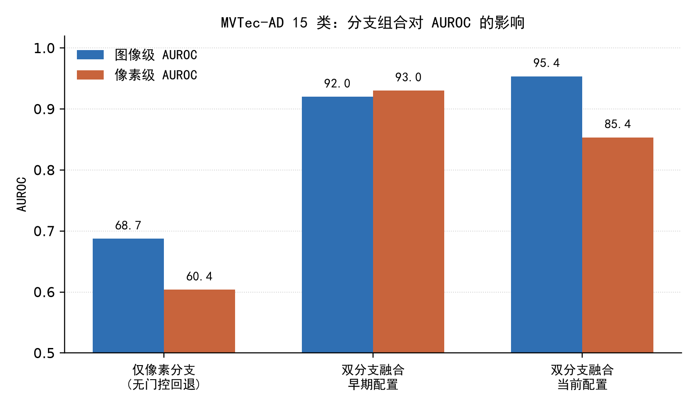

# PCML：纹理—语义双分支的像素级融合异常检测

PCML 是一个面向工业表面缺陷检测的**检索式异常定位框架**：以冻结的 CLIP ViT-L/14-336 为共享骨干，把「PatchCore 纹理检索」与「CMGL 提示式语义分支」两路证据在像素级对齐后融合，输出图像级异常分与 37×37 的缺陷热图。

与本站另一栏目 UEF-Net 是**两个独立项目**：UEF-Net 是论文方法（证据冲突建模 + 门控折扣，不使用目标类样本）；PCML 是一套可运行的工程实现，采用跨域迁移 + 目标类正常样本建库的路线。两者的模块命名有重合，但含义不同，请勿混读。

## 技术路线

| 环节 | 做法 |
|---|---|
| 共享骨干 | CLIP ViT-L/14-336，全参数冻结，输入 518×518 |
| 纹理分支 | 第 6/12/18/24 层 patch token 拼接为 4096 维，PatchCore 记忆库最近邻检索，输出 37×37 纹理距离图 |
| 语义分支 | 可学习提示 + 不确定性对齐模块 UAFM + 轻量 Transformer，逐层 37×37 异常响应求平均 |
| 分支对齐 | CBE：4096→256 与 1024→256 双向交叉注意力，拼接为 512 维，再过两层空间 Transformer |
| 像素构造 | 每像素 16 维：纹理 3（值/3×3 均值/3×3 标准差）+ 语义 3（同构）+ 跨分支 8 + 位置 2 |
| 像素判别 | 类别感知 MLP（784→64→32→1），按 12 个类别原型的余弦相似度选类，不足阈值时 top-2 插值 |
| 融合与回退 | 16 维马氏距离判离群，离群像素比例超阈值时回退为 0.5·纹理 + 0.5·语义 |

## 主要结果

在 MVTec-AD 全部 15 类、源域 VisA 12 类训练的设定下：

- **图像级 AUROC 95.4 / 像素级 AUROC 85.4 / 像素级 AP 52.5 / 像素级 IoU 39.5**
- 源域 VisA 自身 12 类图像级 AUROC 94.5
- 分支对照：仅像素判别分支 68.7，加入双分支融合后 95.4（+26.7 点）

上图为三种分支组合的图像级/像素级 AUROC 对照。三组数值取自两次不同聚合配置的运行，像素级指标不直接可比，逐项口径见[实测结果](results.md)。

## 交付状态

代码在 AutoDL 实例上完成训练与评估，工程目录包含共享骨干加载、PatchCore 记忆库、CBE/像素特征/分类 MLP 训练脚本、批量评估脚本与历史运行日志。评估所需权重与预计算纹理图不在代码包内，复现需按[方法实现](method.md)末尾的清单补齐。

- 入口：[概览](index.md) · [方法实现](method.md) · [实测结果](results.md)
