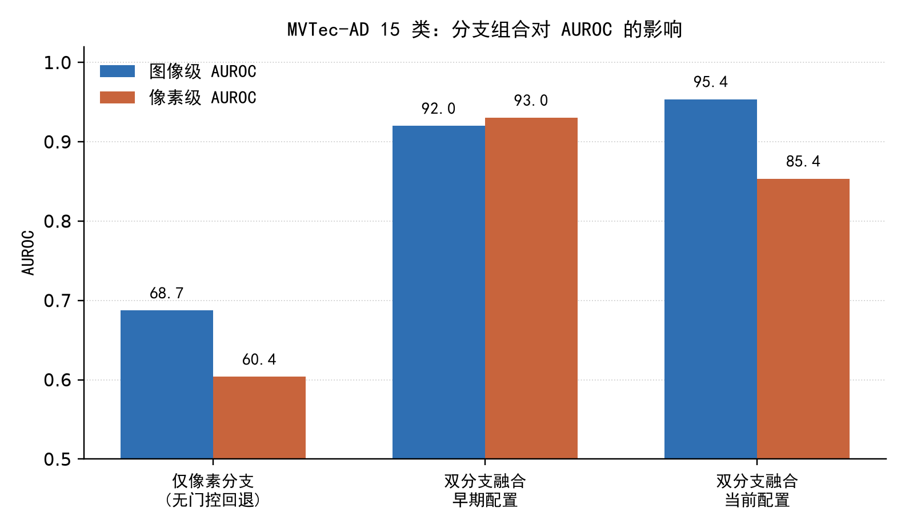

# 实测结果与边界

以下数字全部取自本项目在 MVTec-AD 上的实际评估记录，**不含论文宣称值**。目标域为 MVTec-AD 全部 15 类，融合头与类别 MLP 在源域 VisA 上训练。

## 1. 配置对照

| 配置 | 图像级 AUROC | 像素级 AUROC | 图像级 AP | 像素级 AP | 图像级 F1 | 像素级 F1 | 像素级 IoU |
|---|---|---|---|---|---|---|---|
| 仅像素判别分支（无回退） | 68.7 | 60.4 | — | — | — | — | — |
| 双分支融合 · 早期配置 | 92.0 | **93.0** | 96.6 | 45.9 | 92.8 | 51.4 | 35.3 |
| 双分支融合 · 当前配置 | **95.4** | 85.4 | 94.6 | **52.5** | 88.1 | **55.6** | **39.5** |

两点读法：

- **融合是决定性的**。只走像素判别分支时图像级 AUROC 仅 68.7，加入双分支融合后升至 95.4，提升 26.7 点；这也说明 16 维像素特征 + 类别 MLP 单独使用并不成立，其价值依赖与检索分支的融合。
- **两套配置各有短长**。早期配置像素级占优（93.0），当前配置图像级占优（95.4）且像素 AP 更高（52.5 vs 45.9），但像素 AUROC 低 7.6 点。两次运行的像素聚合口径不同，不能横向比较，需统一重跑才能定版。

## 2. 逐类表现

以下数值取自两份不同的评估记录，仅用于观察极值分布，不宜逐项对比：

| 类别 | 图像级 AUROC | 像素级 AUROC | 观察 |
|---|---|---|---|
| leather | 1.000 | — | 纹理单一，异常对比强烈 |
| tile | 1.000 | — | 同上 |
| bottle | 0.994 | 0.934 | 几何规整类，双指标均稳 |
| transistor | 0.908 | 0.773 | 微小偏移类，像素级偏低 |
| screw | 0.816 | — | 小目标 + 高反光，图像级最弱 |

规律是：**大尺度、纹理型缺陷（皮革、瓷砖）接近饱和；微米级位移与小目标（晶体管、螺丝）是短板**，这也与 37×37 的 patch 分辨率（每格约 14 像素）一致——小于一个 patch 的缺陷在像素图上无法成形。

## 3. 指标口径

| 指标 | 定义 |
|---|---|
| 图像级 AUROC | 以整图异常分为排序依据，15 类合并计算 |
| 像素级 AUROC | 37×37 分数图上采样到 518×518，与真值掩膜逐像素比对 |
| AP / F1 / IoU | 像素级；F1 的阈值在测试集上取最优 |

**F1 与 IoU 是乐观上界**：阈值由 `precision_recall_curve` 在同一测试集上择优选取得出，不具备部署意义。AUROC / AP 不受此影响。

## 4. 已知的评测边界

如实列出四条，它们决定了这些数字可以怎么引用：

1. **源域是有监督的**。融合头在 VisA 的测试划分（按类 7:3）上训练，训练时使用真值掩膜，因此不属于无监督设定。
2. **目标域正常样本参与了建模**。MVTec 每类评估前都用该类 `train/good` 重建 PatchCore 记忆库，并用这批样本拟合离群统计。这属于「跨域迁移 + 目标类正常建库」，**不是严格零样本**——严格零样本应只保留源域记忆库。
3. **像素级 AUROC 存在两套口径**（93.0 与 85.4）。两份历史结果文件的聚合设置不同，其中一份只完成了 2 类即中断，其均值不可直接引用；当前以 15 类完整记录的 85.4 为准。
4. **图像分数做了按类 min-max 归一**。该操作不改变 AUROC，但会让跨类统一阈值的 F1 失去意义。

## 5. 工程现状与待修项

代码当前存在几处会改变结果的实际问题，均已定位：

| 问题 | 影响 | 修法 |
|---|---|---|
| 离群阈值取 3.0，而 16 维平方马氏距离的零分布期望为 16 | 实测离群比例 100%，整图恒定回退，MLP 分支在 95.4 里未生效，等效于固定等权融合 | 阈值改为正常样本距离的分位数（如 99.5% 分位），或按 χ²(16) 对齐到 26–30 |
| 建库阶段用全零纹理图计算 16 维特征，再以此拟合离群统计 | 离群统计建立在错误输入上 | 先建库、再算 16 维特征、最后拟合 |
| 合并脚本只取单类的融合头权重 | 其余 11 类训练出的共享模块被丢弃，与「共享 CBE」设计不符 | 改为合并共享模块，或按类保留 |
| 残差修正脚本调用了不存在的检索/距离接口 | 该变体无法直接运行 | 对齐接口或废弃该路径 |
| 子采样为随机 10%，而非贪心 k-Center | 记忆库代表性弱于原版 PatchCore | 换贪心 k-Center，代价是建库时间上升 |

## 6. 后续方向

1. **重标定回退阈值**，让门控真正按像素选择性生效，再看图像级与像素级指标分别升降多少；
2. **统一一次 15 类全量重跑**，落盘单一份含 7 项指标的结果文件，废弃其余历史口径；
3. **严格零样本对照**：去掉目标类记忆库、只用源域库直接检索，如实报告掉分幅度；
4. **提升小目标分辨率**：37×37 对微米级缺陷不够，考虑提高输入或引入局部放大分支。
