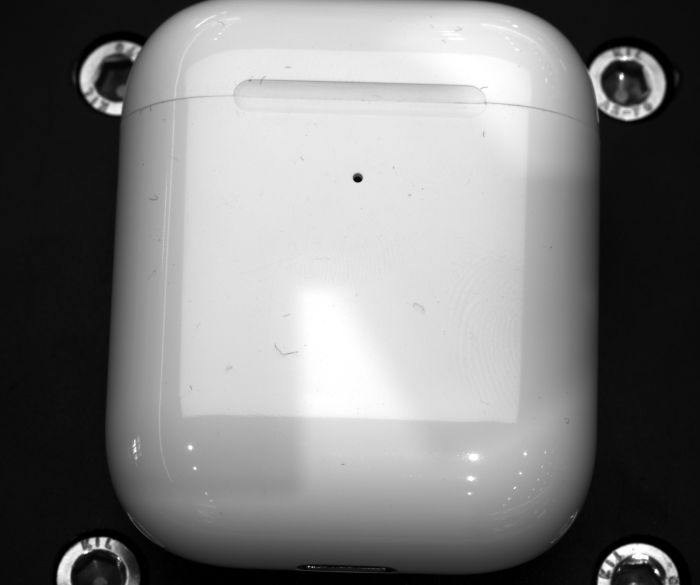
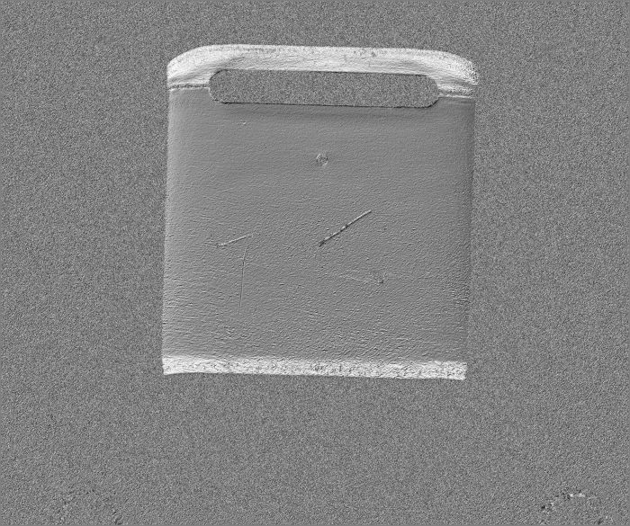
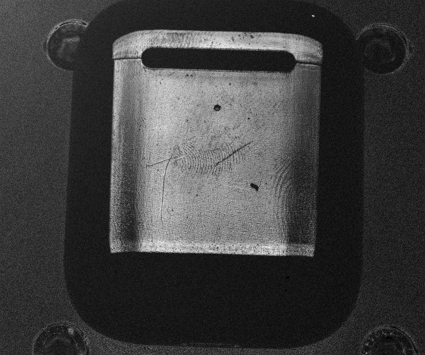
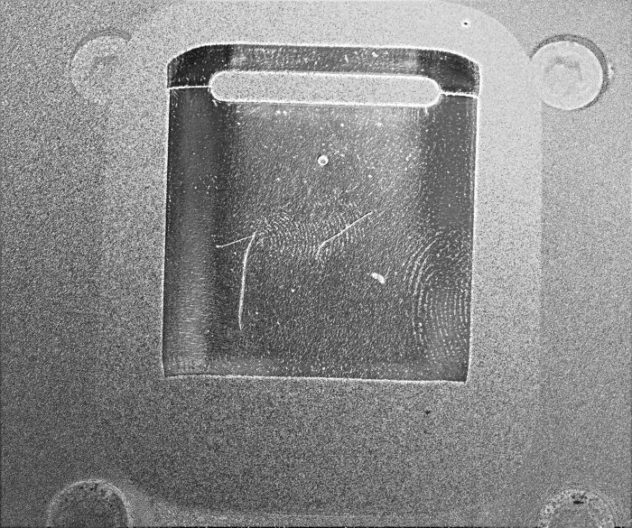
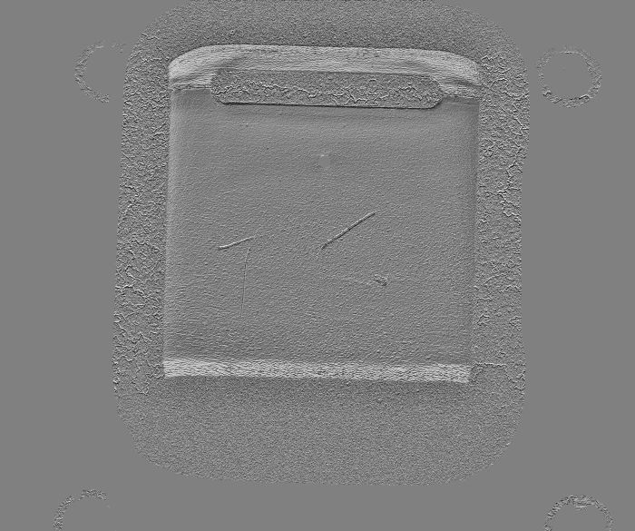
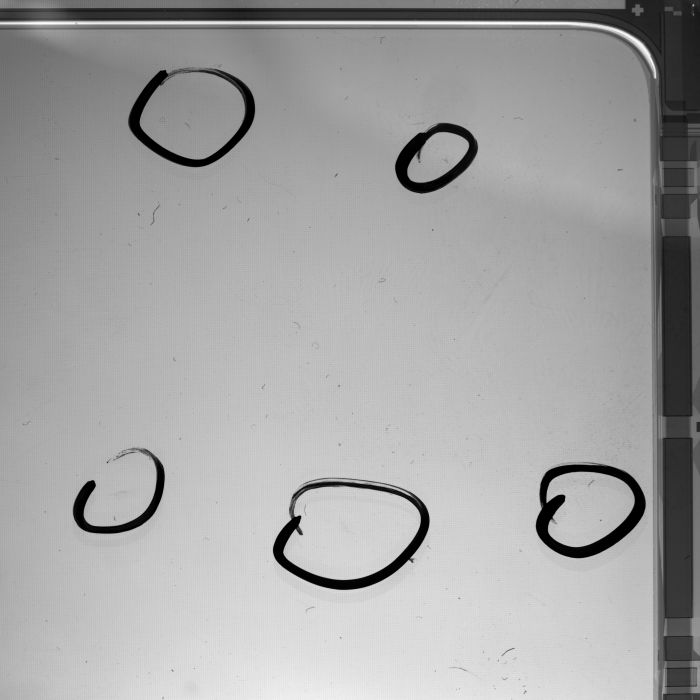
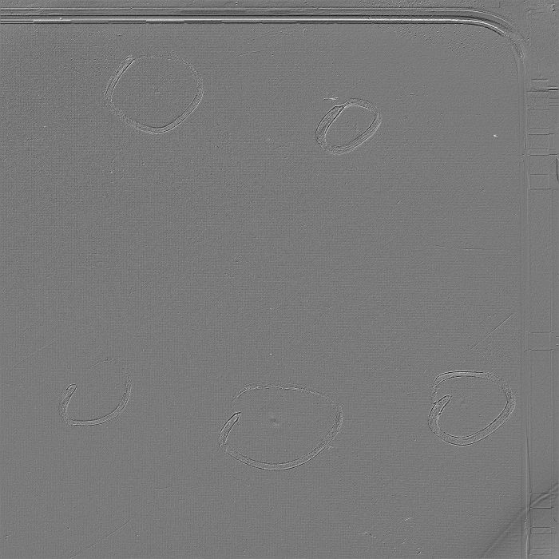
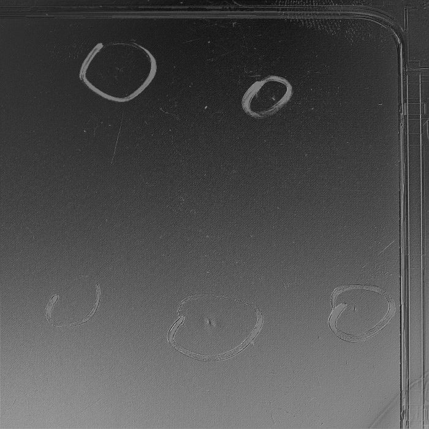
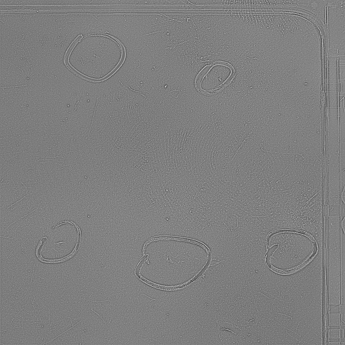
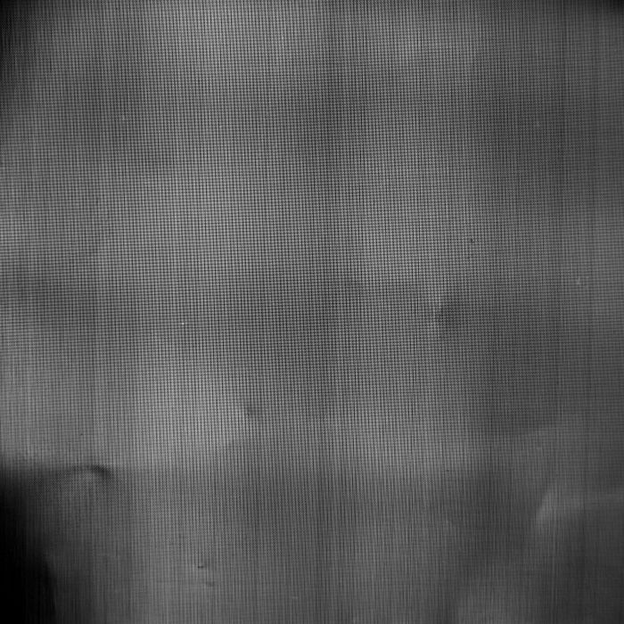

# 结果预览

> 当前为**定性验证**：在真实光泽工件上展示缺陷是否被显现；缺陷对比度、信噪比、消融对比与单帧耗时等定量指标待补，暂不报告检测率。

## 耳机充电盒（光泽表面：划痕 + 指纹 + 针孔）

PMD 灰度原图近乎过曝的白壳，人眼几乎看不到缺陷；PMD 斜率图暴露几何划痕，光度通道反过来显现指纹涡纹与针孔；融合结果在一张图里同时给出两类缺陷。

| 阶段 | 图示 |
|---|---|
| PMD 灰度原图（过曝） |  |
| PMD 斜率图（几何划痕） |  |
| 镜面分量 |  |
| 光泽分量 |  |
| 虚拟 PS 渲染图（NW 光源） |  |
| PS 法线 X |  |
| PS 反照率 |  |
| 融合法线 X |  |
| 缺陷强度图 |  |
| 标准 DoG 浮雕 |  |
| CLAHE 浮雕 |  |
| 几何划痕通道 |  |
| 光度指纹通道 |  |
| 最终融合结果 |  |

## 屏幕盖板（玻璃表面细划痕）

近空白的光泽盖板上，浮雕 / CLAHE 通道额外显出定位圈之间的发丝划痕与面板微纹理。

| 阶段 | 图示 |
|---|---|
| 灰度原图 |  |
| PMD 斜率 X |  |
| PS 法线 X |  |
| CLAHE 浮雕 |  |

## 漫反射面板

在更漫反射的表面上，光泽权重自然把信任转向 PS，说明融合权重随零件反射特性自适应，而非假定单一反射特性。

| 阶段 | 图示 |
|---|---|
| 灰度原图 |  |
| 缺陷结果 |  |

## 待补充的定量实验

- 人工标注缺陷 ROI 上的缺陷对比度与局部信噪比，对比仅 PMD / 仅 PS / 融合三种方案；
- 与商用基线结果并排或做差对比；
- 消融：固定 0.5 融合（去掉光泽权重）、去掉双边滤波、去掉软阈值；
- 单帧耗时统计。
