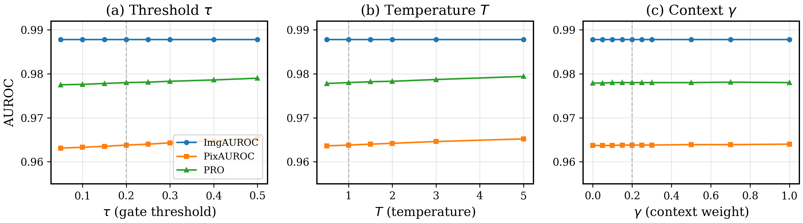
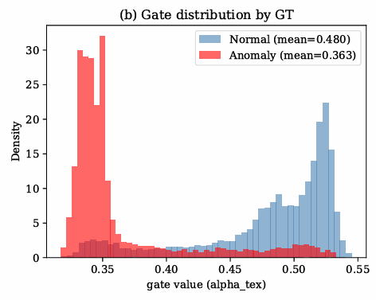
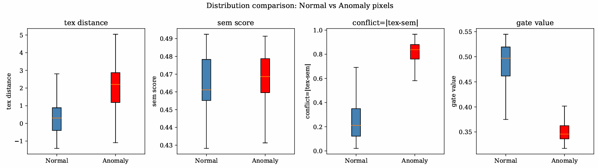
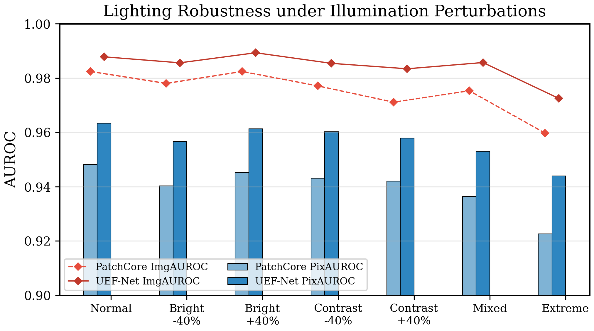

# 机制分析

## 超参数敏感性

在较宽范围内扫描门控阈值 τ、温度 T 与上下文权重 γ，三项指标曲线均近水平。这种稳定性不是调参的结果，而是融合头构造决定的：可训练部分只有轻量 MLP，门控主体是规则算子，决策由可解释的冲突统计驱动，超参只调节门控曲线形状。

- 冲突值集中在 0–0.3 的窄区间，τ 漂移时门控系数始终落在 0.47–0.55 的温和混合区间，不改变两路证据的相对强弱。
- T 只调节混合的软硬程度；过大时趋于硬开关，才带来约 1–2 个百分点的小幅下降。
- 局部—全局两级冲突统计已刻画邻域与整体分歧，γ 控制的邻域二次修正属冗余平滑，贡献有限，取默认 0.2 即可。

总体上，"冲突度量驱动 + 规则算子 + 温和混合门控"的设计使超参不敏感、决策依据可复核，便于跨产线参数复用。

## 门控机制可视化

在 carpet、bottle、transistor 三类上分层采样正常像素 9000 个、异常像素 8590 个，分别从门控系数的分布与四个信号的箱线图观察融合行为。

异常像素的门控系数集中在低区间（均值 0.363，主峰约 0.35），正常像素集中在高区间（均值 0.480，主峰约 0.52），两分布主体分离。异常处两路冲突增大，门控相应下调、远离 0.5 的固定混合；正常处冲突较小，维持接近 0.5 的混合。这说明门控不是常数混合器，而是随冲突自适应加权，也解释了 gate_off（固定 0.5）因无法在高冲突位置调整权重而掉点。需要强调：门控本身不判定异常，判别仍由最终异常分完成。

四幅子图对应信号从分支响应、冲突提炼到门控输出的传递链条：

| 信号 | 正常中位数 | 异常中位数 | 作用 |
|---|---|---|---|
| 纹理距离 tex | 0.3 | 2.3 | 区分度最强的单分支判别依据；局限是纹理波动会在背景产生椒盐噪声 |
| 语义分数 sem | ≈0.46 | ≈0.46 | 两类几乎重合、单独不具备判别力，提供不随纹理起伏的稳定背景参照 |
| 冲突值 abs(tex − sem) | 0.20 | 0.82 | 继承 tex 判别力的同时以绝对值消除差值方向噪声，是干净的触发信号 |
| 门控值 gate | 0.498 | 0.348 | 分离方向与 conflict 一致，证明门控确实在像素级执行差异化加权，而非固定等权混合 |

## 光照鲁棒性

纯纹理记忆库方法（如 PatchCore）依赖正常样本的纹理距离建模，光照与对比度退化会放大纹理距离波动，使边缘与背景更易被判为异常。为检验现场成像条件波动下的可用性，在 MVTec AD 测试集施加七组扰动——亮度 ±40%、对比度 ±40%、混合扰动（亮度 0.6 / 对比度 1.4）、极端扰动（亮度与对比度均减半）——与 PatchCore 对比。

| 条件 | UEF-Net 相对 PatchCore（图像级 / 像素级） |
|---|---|
| 正常条件 | 已小幅领先 |
| 单一扰动（亮度/对比度 ±40%） | 优势随扰动增强而扩大 |
| 混合扰动 | +1.1 / +1.7 个百分点 |
| 极端扰动 | 增益扩大至 +2.1（图像级 / 像素级均领先） |

极端扰动下 PatchCore 的图像级与像素级 AUROC 分别下降 2.2、2.5 个百分点，UEF-Net 仅下降 1.5、1.9，像素级仍保持 94.4%。扰动越强、条件越复合，两类方法的差距越大。

这一差距来自双分支互补与门控回退：CLIP 语义相似度对亮度偏移不敏感，提供稳定的参照信号；当光照漂移使纹理距离与语义响应出现分歧时，门控回退融合，抑制被光照扰动放大的纹理假阳性。因此在退化成像条件下，UEF-Net 仍能保持较好的缺陷定位精度，相对纯记忆库方法具备更强的现场可用性。
