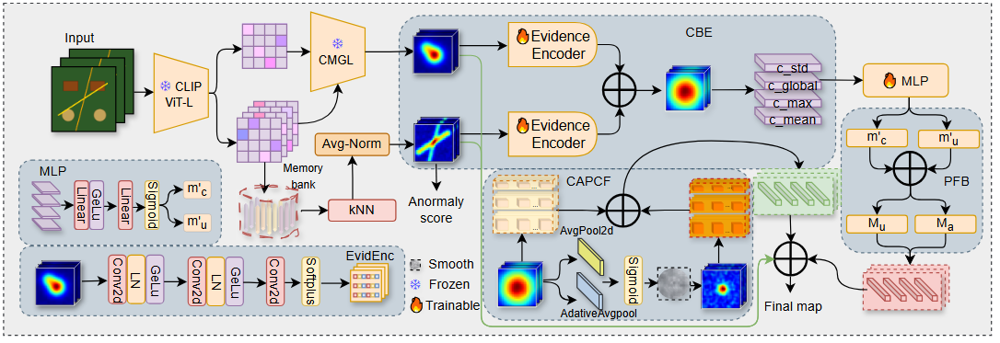
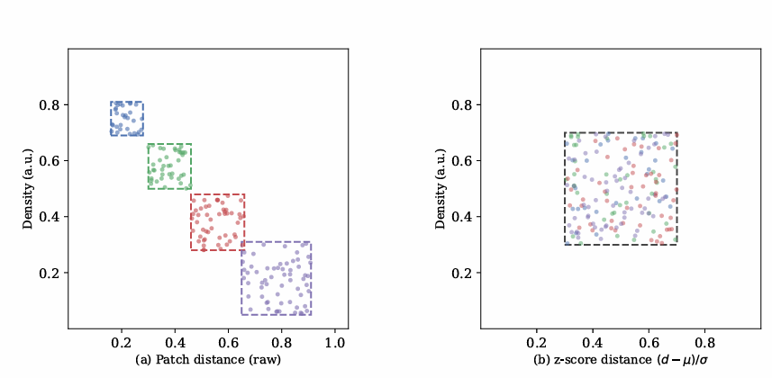
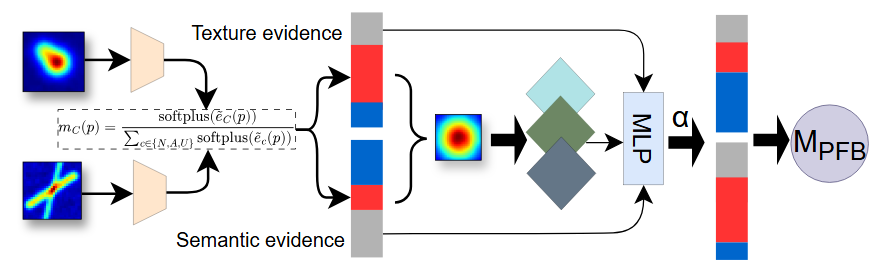
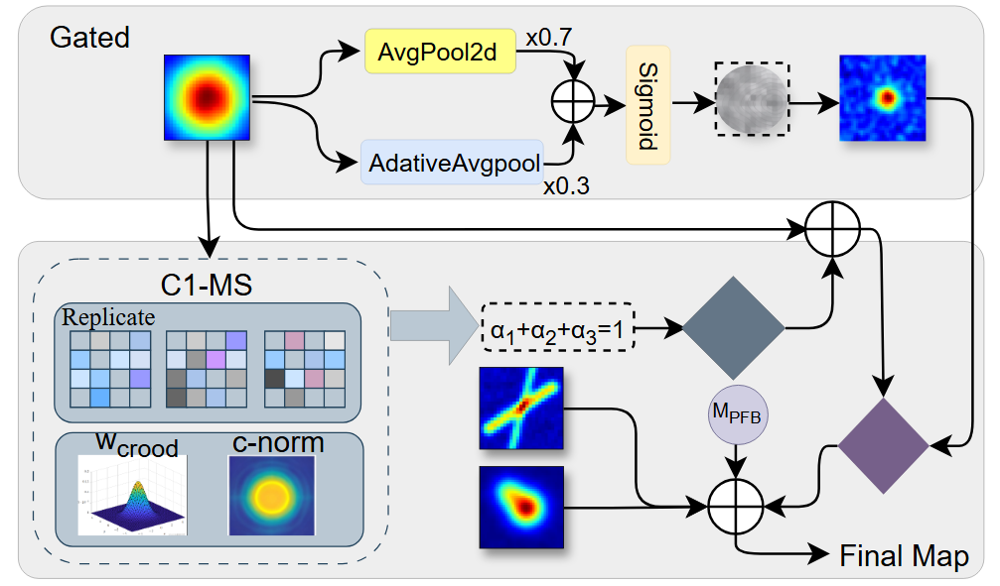

# 方法架构

## 问题定义

零样本工业异常检测要求在目标评测类别**不使用任何正常或异常样本、不使用缺陷像素掩码**的条件下，判断输入图像 `I` 是否存在未见异常，输出图像级异常分数 `S(I)` 与像素级异常图 `P(I)`。

模型只在外部辅助数据集上学习领域提示、特征投影与融合模块，辅助集与评测类别互不相交；评测目标类不参与任何训练或建模，异常样本及其像素掩码仅在评测时用于计算像素指标。

## 整体框架



推理链条自上而下分三段：冻结编码器抽取多尺度补丁特征后送入视觉、语义两条分支；两路异常图由 CBE 编码为三类证据并自适应折扣，再由 PFB 组合为融合证据与保守异常分；CAPGF 按像素冲突逐像素加权，输出最终像素图，并由融合响应聚合得到图像级分数。

## 双分支异常响应构造

### 视觉分支

视觉骨干取 ViT 第 6、12、18、24 层特征输出，第 `l` 层补丁特征记为 `F_l(p)`（`p` 为 37×37 网格位置）。浅层编码局部纹理与边缘，深层编码全局结构。各层特征经共享投影层映射到对比嵌入空间，与该层在辅助集上学到的领域文本原型计算相似度偏差，作为该层的视觉异常响应；本分支**不构建面向目标类的正常样本记忆库**。

为消除层间量纲差异，在正常参考样本上估计每层的距离均值与标准差，对距离做逐层 z-score 标准化：



标准化后按等权规则融合（`L=4`，无可训练参数）得到最终视觉（纹理）异常图：

```text
T(p) = (1/4) * Σ_l ( d_l(p) − μ_l ) / σ_l
```

### 语义分支

语义分支由可学习领域提示封装层构成，提示参数在外部辅助集上学习，CLIP 视觉编码器冻结。领域提示生成"正常/异常"及工件属性文本嵌入，与逐位置视觉特征匹配，输出 37×37 语义异常响应图，表征该位置语义偏离正常的程度。该响应图直接作为语义分支证据使用。

## 联合证据估计与聚合



### 证据编码（CBE）

辨识框架为 `{N, A, U}`（正常、异常、不确定）。每个分支在像素 `p` 输出三个证据质量，满足 `m_N + m_A + m_U = 1`。

两路异常图分布差异较大，共享一套权重难以同时拟合，因此各配一个结构相同、参数独立的证据编码器：输入单通道异常图 → Conv 1→16 + LayerNorm + GELU → Conv 16→16 + LayerNorm + GELU → Conv 16→3 得到原始证据，经 softplus 非负激活后沿通道维 L1 归一化：

```text
m_c(p) = softplus(ẽ_c(p)) / Σ_{k∈{N,A,U}} softplus(ẽ_k(p))
```

### 冲突度量与自适应折扣

两路证据在像素 `p` 的冲突度取相互对立项乘积之和：一方判正常、另一方判异常时冲突增大，意见一致时趋近于零。

单像素冲突易受孤立噪声干扰，故不取单点值，而取冲突图 `K` 的**空间均值、标准差、最大值与平均不确定度**组成四维冲突统计，经小型 MLP 与 Sigmoid 输出折扣系数 `α`。折扣把原证据按比例转移至不确定项：

```text
m'_N = α·m_N,  m'_A = α·m_A,  m'_U = 1 − α·(m_N + m_A)
```

冲突越大 `α` 越小，越多质量转入不确定项。

### 证据聚合（PFB）

折扣后的视觉证据与语义证据在 PFB 中执行 Dempster 组合，输出融合后的正常、异常、不确定质量并再次归一化，保证三者之和为 1。组合后一致支持的状态相互强化；一方明确、另一方证据不足时保留明确判断；两路均无法判断时质量集中到不确定项。

像素异常分采用"异常证据 + 不确定证据加权"的保守形式：

```text
s(p) = m_A(p) + λ·m_U(p),   λ = 0.5
```

保留不确定项的正向贡献，使证据不足处不被压为低分、高冲突区也不被过度自信判为异常；不确定像素维持中等响应。

## 冲突感知像素门控融合（CAPGF）



纯证据组合在两路高度对立时仍可能给出偏高分数，因此需要一条位于聚合之外的回退路径。CAPGF 接收融合证据、冲突图 `K` 与两路原始响应，在像素粒度决定学习型结果的采纳程度。

**局部—全局两级冲突统计**：局部项取平均池化刻画邻域冲突趋势、保留细节；全局项自适应平均池化到低分辨率再双线性上采样回原分辨率，刻画整体分歧。两项按 0.7 与 0.3 加权。

**门控系数**由阈值 `τ` 与温度 `T` 经 Sigmoid 映射：

```text
g(p) = sigmoid( (τ − c(p))·T )
```

`τ` 是"采用学习型证据融合还是退回等权融合"的判定阈值，`T` 控制曲线陡峭程度。门控图再以高斯核做空间平滑，避免椒盐状跳变。

**C1-MS 多尺度上下文候选**：在逐像素门控基础上，用邻域低冲突邻居的门控值修正当前像素。每个尺度先 replicate 填充并展开邻域，坐标权重按二维高斯衰减，冲突值先做 min-max 归一化再参与加权：

```text
w(p,q) ∝ exp( −‖p−q‖² / (2σ²) ) · c_norm(q)^k,   k = 2.0
```

窗口内取权重最大的若干邻居，其余置零后重新归一化，得该尺度的上下文候选门；三个尺度候选按权重融合为多尺度上下文门控，最终门控在原始门控与上下文候选之间按混合系数 `γ` 线性插值。`γ=1` 时上下文分支不执行，门控与单尺度结果逐位一致；`γ` 小于 1 时引入邻域低冲突邻居的门控值，使门控具有空间连续性（默认 0.2）。

**最终像素异常图**为学习型融合图与等权保守融合图的逐像素线性混合：

```text
P(p) = g(p)·M_fused(p) + (1 − g(p))·[ 0.5·T(p) + 0.5·S(p) ]
```

低冲突位置由学习型证据结果主导；高冲突位置学习型结果被抑制，回退到视觉与语义各占 0.5 的等权融合。门控本身不判定像素是否异常，判别仍由最终异常分在分数轴上完成；它只作用于"分歧大、易被误判为异常"的像素子集，以低置信度平均响应替代高冲突自信投票，压低纹理波动造成的假阳性，同时不改变一致异常区域的高分。

## 损失函数

训练只在外部辅助集上优化提示层、特征投影与融合模块，CLIP 骨干冻结，以图文对比损失与图像级标签监督，**不使用像素掩码**。总损失由图文对比损失、排序损失与证据正则损失加权组成。

排序损失对融合异常图取 Top-k 响应均值作为图像级异常分数，与图像级标签做二分类交叉熵，使图像级排序能力与像素融合图保持一致（Top-k 取值见实现细节）。

证据正则由不确定度、冲突对比、证据熵、折扣系数与跨分支对齐五项组成。辅助训练集缺乏异常像素标签，交叉熵与分割损失无法直接使用；五项正则分别用于：让正常样本证据自信落在 `m_N`；用图像级弱监督让异常输入产生更高冲突；防止证据塌缩；约束折扣不要极端；对齐两路证据尺度。这是无需像素级标签即可训练提示与融合模块、进而跨类别泛化的关键。

## 实现细节

| 项目 | 取值 |
|---|---|
| 视觉骨干 | CLIP ViT-L/14（336 预训练） |
| 输入分辨率 | 518×518 |
| 特征层 | 第 6 / 12 / 18 / 24 层 |
| 异常图网格 | 37×37 |
| 门控阈值 τ / 温度 T | 0.2 / 1.0 |
| 上下文混合系数 γ | 0.2 |
| 图像级 Top-k | 50 |
| 不确定度权重 λ | 0.5 |
| 优化器 / 学习率 | Adam / 1×10⁻⁴，余弦退火 |
| 权重衰减 / 批大小 / 轮数 | 1×10⁻⁵ / 32 / 50 |
| 梯度裁剪 | 1.0 |
| 训练硬件 | 单张 H20 32GB |

> 上述超参数为论文 v1.0.0 报告的默认配置；论文正文中对记忆库 coreset 比例与逐层标准化配置仍标注为待按最终零样本设定复核，本页只列出与当前实现一致的项。
