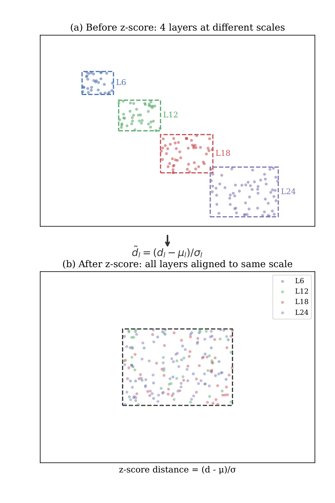
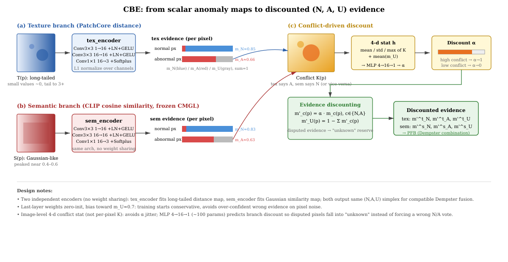
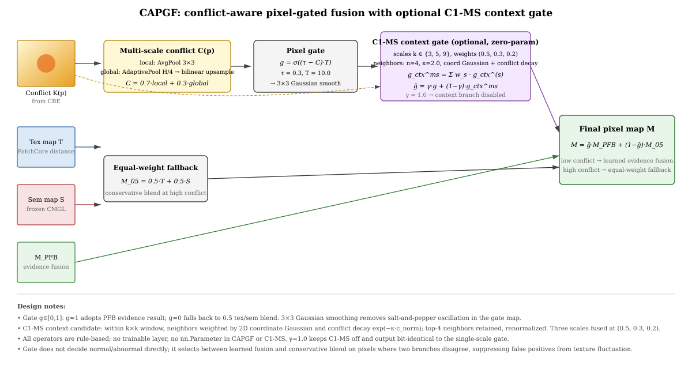

# 方法架构

UEF-Net 的特征与融合流程自上而下分为六段。除 CBE 证据融合头外，其余阶段均为零参数规则算子或冻结特征分支。下图依次给出纹理归一化、证据融合与像素门控三个关键模块的结构。

## 1. 多尺度纹理分支（MultiScalePatchCore）

- 零参数；逐层子库 + z-score 归一化（avg_norm）后四层等权聚合。
- 特征层取第 6 / 12 / 18 / 24 层，输入分辨率 518×518，每维 1024。
- coreset 抽样比例 0.05；图像异常分取纹理图 top-50 均值。

## 2. 冻结语义分支（CMGL）

- CLIP 视觉/文本骨干全程冻结，语义特征在推理时只读。
- 语义投影、领域提示等封装在语义分支内；辅助训练只发生在辅助数据集头，不回写骨干。

## 3. 证据融合头（CBE）

CBE 是全模型唯一可训练段，约 **181,256** 个参数，训练于辅助数据集（VisA）的零样本头；主干评测时冻结使用。结构包含：

- 双 EvidenceEncoder：分别编码纹理与语义证据；
- ConflictEstimator：估计两路证据的冲突程度；
- 双 AdaptiveDiscount：按冲突对证据置信度做自适应折扣。

## 4. 证据组合（PFB）

- 无参数；采用 Dempster 式组合规则。
- 组合后信任质量 `m_A + λ·m_U`，其中未知度权重 λ = 0.5。

## 5. 像素门控融合（CAPGF）

CAPGF 为规则型零参数门控，逐像素混合纹理与语义响应：

1. 多尺度冲突：0.7 局部 3×3 平均池化 + 0.3 全局自适应平均池化；
2. 门控激活：`sigmoid((τ − c)·T)`，默认 τ = 0.4、T = 3.0；
3. 3×3 高斯平滑；
4. C1-MS 多尺度上下文门控（尺度 3/5/9，权重 0.5/0.3/0.2）；
5. 与 0.5 等权融合图逐像素混合；门控关闭态（β=0 / γ=1）与基线逐位一致，作为交叉校验锚点。

## 6. 输出层

- **图像异常分**：纹理图 top-50 均值；
- **像素缺陷图**：门控融合图上采样至 518×518。

## 关键超参口径

| 项目 | 取值 |
|---|---|
| 特征层 | [6, 12, 18, 24] |
| 输入分辨率 | 518×518 |
| 图像 top-k | 50 |
| coreset 比例 | 0.05 |
| 冲突阈值 τ / 温度 T | 0.4 / 3.0 |
| 平滑核 | 3×3 |
| 未知度权重 λ | 0.5 |
| 上下文网格 | 37×37 |
| 逐层库权重 | [0.25, 0.25, 0.25, 0.25] |
