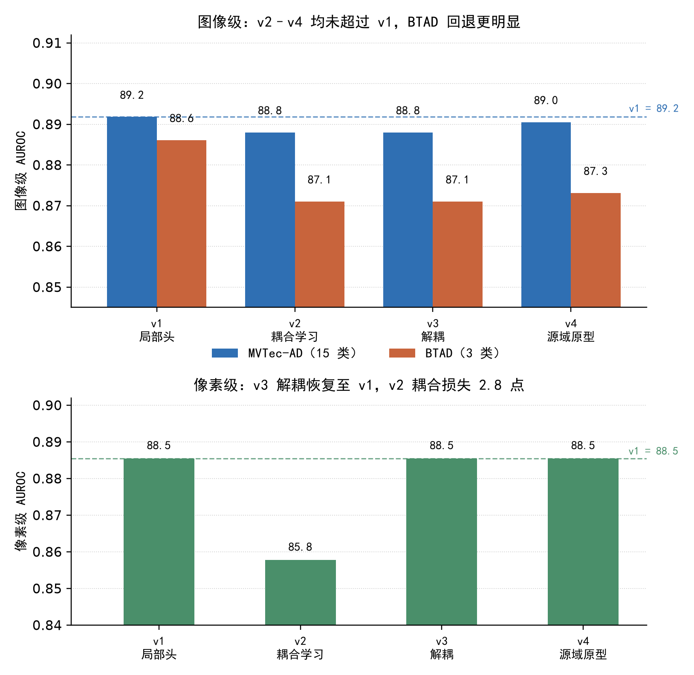

# 研究进展（截至 2026-11-28）

本页记录主线定稿之后的工作：一条新的局部学习分支（v1–v4）、一次评测指标的重新定义、以及九套 SOTA 基线的归集。**结论先说：新分支四轮全部在目标域回退，主线数值不变。**

## 状态总览

| 分支 | 骨干与思路 | 最新状态 | 目标域表现 | 是否进论文 |
|---|---|---|---|---|
| 主线 UEF-Net | CLIP ViT-L/14-336 + 多尺度纹理库 + 证据门控 | 已定稿 | MVTec 图像 98.8 / 像素 96.9 | 是 |
| 局部学习 v1 | DINOv3 ViT-L/16 冻结 + 约 16 万参数局部头 | 保留为分支基线 | MVTec 89.2 / 88.5；BTAD 88.6 | 否 |
| 局部学习 v2–v4 | 耦合 / 解耦 / 源域原型 | 均已判负 | 四轮全部未超过 v1 | 否 |
| 指标重定义 | AUPRO 与 F1 口径重写 | 已生效 | 新旧指标不可直接比较 | 是 |
| SOTA 基线 | 九套开源方法归集 | 部分适配完成 | 见[对比实验](sota.md) | 是 |

## 1. 时间线

| 日期 | 工作 | 产出 | 结论 |
|---|---|---|---|
| 11.24 | 远程评测脚本族建立 | 骨干对照、1-shot 曲线、弱类检索、纯纹理、少样本等多支脚本 | 评测入口统一 |
| 11.25 | CLIP 与 DINOv3 骨干对照首跑 | CLIP 518/网格 37 与 DINOv3 512/网格 32 两套 | CLIP 支路在 16 GB 卡上因手写注意力矩阵溢出，见下节 |
| 11.26 | SubspaceAD 适配、双尺度编码器分支 | few-shot PCA 子空间基线可运行 | SubspaceAD 属 few-shot，不进零样本主表 |
| 11.27 | 指标修复与门控校验 | `metrics_v2`、AUPRO 重定义、门控权重质量检查 | 旧指标作废，早期数字不可复用 |
| 11.27 | 局部学习 v1 | 源域选定局部头（MIL + 合成缺陷） | MVTec 图像 0.4692 → 0.8918 |
| 11.27 | 局部学习 v2 | 三随机种子 + 集成 | 目标域全面回退 |
| 11.27 | 局部学习 v3 | 图像与定位分支解耦 | 像素恢复至 v1，图像仍为 v2 |
| 11.28 | 局部学习 v4 | 源域正常原型库 + 图像融合 | 图像 −0.13 / −1.30 点，仍不及 v1 |

## 2. 指标被重写，旧数字作废

11-27 的修复把评测口径整体替换，这不是微调，而是换了尺子：

| 项 | 旧口径 | 新口径 |
|---|---|---|
| 图像指标 | 仅异常图参与 | 全部正常与异常测试图参与，异常图缺掩码即报错 |
| AUPRO | 自定义积分 | FPR ≤ 0.30、4096 级阈值近似、区域等权、256×256 网格、4 邻域连通 |
| F1 / IoU | 单点阈值 | 完整 PR 曲线取最优，明确标记为 oracle 指标 |
| 门控权重 | 无校验 | 强制检查尺度、偏置、NaN，禁止随机门控参与推理 |

因此**本轮及以后的任何数字都不能与 11-26 之前的结果直接相减**。这也是下文局部学习基线（图像 0.4692）看起来异常低的原因之一——它是在新口径下重算的旧结构。

## 3. 局部学习：四轮全部负结果

思路是把"图像级判别"与"像素级定位"交给一个冻结 DINOv3 骨干上的轻量局部头：浅/中/深三组 patch 特征经固定正交投影压到 128 维缓存，头部输入为 patch 与其 5×5 邻域差分，约 16 万参数；图像分取最高 16 个 patch 均值。训练监督来自外部辅助域的图像标签，以及由辅助域正常图合成的 768 张带掩码局部缺陷图。

| 版本 | MVTec 图像 | MVTec 像素 | MVTec 像素 AP | MVTec PRO | BTAD 图像 | BTAD 像素 |
|---|---|---|---|---|---|---|
| 旧多原型基线 | 0.4692 | 0.8598 | 0.1960 | 0.7020 | — | — |
| v1 局部头 | **0.8918** | **0.8855** | **0.4265** | **0.8552** | **0.8861** | **0.9462** |
| v2 耦合学习 | 0.8880 | 0.8578 | 0.3831 | 0.8046 | 0.8710 | 0.9341 |
| v3 解耦 | 0.8880 | 0.8855 | 0.4265 | 0.8552 | 0.8710 | 0.9462 |
| v4 源域原型 | 0.8905 | 0.8855 | 0.4265 | 0.8552 | 0.8731 | 0.9462 |

三条读法：

- **v1 的价值来自修好了坏掉的图像分支，不是来自"学习"本身**。旧结构图像级 0.4692 低于随机，v1 把它拉到 0.8918；但像素级只从 0.8598 升到 0.8855，定位能力本来就在。
- **v2 的耦合把定位拖坏了**。像素级从 88.5 掉到 85.8（−2.7 点），像素 AP 从 42.6 掉到 38.3。v3 把两分支解耦后定位回到 v1，但图像仍是 v2 的水平——说明耦合不是"顺手带上"，而是真实的负迁移。
- **v4 的原型证据接近无效**。原型单独作为图像证据只有 0.4963（等同随机）；与 v2 融合后 0.8905，仍低于 v1 的 0.8918；BTAD 上退 1.3 点。

### 最重要的一条：源域选型与目标表现背离

v2 三个种子在辅助域 VisA 保留类上的图像 AUROC 为 0.9257 / 0.9433 / 0.9578，按源域指标选出的最优种子是 0.9578；v4 的融合候选在源域达到 0.9579，**比 v1 的 0.9351 高 2.3 点**。但这些"源域最优"配置在 MVTec 与 BTAD 上全部回退。

这不是实现问题，而是选型准则的问题：**在辅助域上挑出来的最佳配置，与目标域表现负相关或至少不相关**。由此定下两条纪律：

1. 源域提升不构成目标泛化的证据，只能作为"值得一试"的门槛；
2. 任何融合权重、候选选择与阈值都必须在源域上固定，再一次性读取目标结果，不允许用目标结果回头挑配置。

v3 中源域像素指标更好的候选（0.6027 → 0.6173）也没有被采纳，主方案固定 v1 定位分支——这是刻意放弃"用选型指标顺带优化目标"的做法。

## 4. 骨干对照：一次显存事故暴露的结构问题

11-25 的 CLIP / DINOv3 对照在 CLIP 支路崩溃。根因不在显存容量，而在实现：

- 输入 518，patch 14 → 37×37+1 = 1370 个 token，16 个注意力头，批 32；
- 该支路的注意力是手写实现，且显式要求返回注意力权重，每个 block 都实际创建 32×16×1370×1370 的矩阵，单次约 3.58 GB；
- DINOv3 支路 token 数减半，走融合内核，不创建该矩阵，因此正常。

处理方式是把注意力改为按需返回权重，并改用手写实现的融合内核路径；不再使用的注意力图累加代码一并移除。数学等价，显存占用下降一个量级。这条经验对后续任何扩大输入尺寸的实验都适用。

## 5. 协议边界（引用这些数字前必须知道）

1. **不是 training-free**。局部头在辅助域 VisA 的 8 个类上训练，另 4 类做验证；辅助域真实掩码用于合成缺陷与候选诊断，不能再声称"只用图像级标签"。
2. **MVTec 与 BTAD 已是开发集**。方法结构本身就是照着早期 MVTec 弱点设计的，两套目标集都只能算开发评测，不是未触碰的最终测试。
3. **辅助域与目标域存在语义关联**。VisA 与 MVTec 都含 PCB、齿轮类工件，类别名与路径隔离不等于语义不相交。
4. **SubspaceAD 是 few-shot**。它在目标类 `train/good` 上拟合 PCA，只能进少样本基线表。
5. **LOGIC 源域训练用像素掩码**，与本文图像级弱监督设定不同，记录时不可混写。

## 6. 一处必须解决的口径冲突

主工程与消融脚本的纹理记忆库读的是 `{类别}/train/good`，即**目标类正常训练图参与建库**；而站点方法页与论文写法是"评测类不构建任何正常样本记忆库"。

两者只能成立一个：

- 若"零样本"定义为**不重训、不用目标类测试样本**，那么建库是协议的一部分，需在方法章明确写出"使用目标类正常图建库、零参数更新"；
- 若定义为**不使用目标类任何样本**，那么现有权威数值是在更宽的口径下得到的，需要在严格口径下重测一遍并如实报告掉分。

在这条定下来之前，不建议对外强调"完全不接触目标类样本"。

## 7. 待办

| 优先级 | 事项 |
|---|---|
| 高 | 统一零样本口径（见第 6 节），据此修方法章与站点表述 |
| 高 | 11-24 至 11-26 的骨干对照、1-shot 曲线、弱类检索、双尺度分支结果补落盘为 JSON，避免只剩脚本 |
| 中 | 局部学习 v2–v4 归档为负结果记录，明确不进主表 |
| 中 | 预先注册选型准则（源域指标与目标读数的关系），再开新实验 |
| 低 | 站点论文数值与交接档案的 0.1–0.3 点差异逐项核对到日志 |
