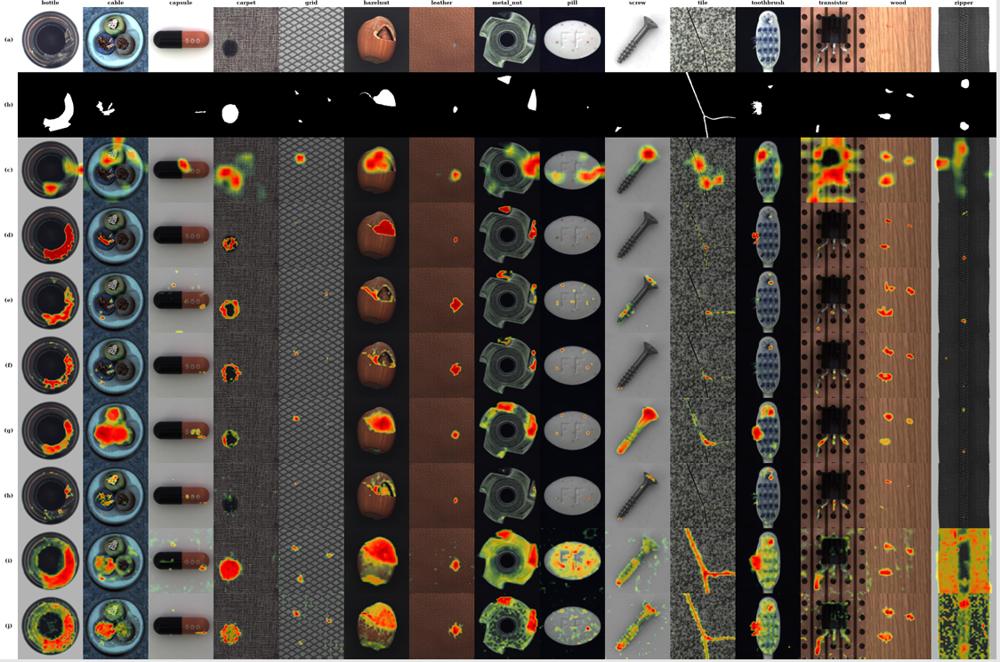

# 实验结果

## 评测设置

### 数据集

实验覆盖五个主流公开数据集，覆盖纹理、机械件、食品与 PCB、皮革、线缆、瓶体等场景：

| 数据集 | 类别数 | 主要异常类型 | 像素掩码 |
|---|---|---|---|
| MVTec AD | 15 | 划痕、断裂、污染、结构错位 | 有 |
| VisA | 12 | 机械件、食品与 PCB 表面缺陷 | 有 |
| BTAD | 3 | 皮革、线缆、瓶体表面异常 | 有 |
| DAGM 2007 | 10 | 纹理与图案微弱扰动 | 弱 |
| DTD-Synthetic | 12 | 纹理合成扰动 | 有 |

### 协议与指标

- 提示层、特征投影与融合模块（CBE + PFB + CAPGF）仅在外部辅助工业数据集上训练，不使用像素级掩码；辅助集与五个评测数据集类别互不相交。
- 评测时直接加载辅助集学到的权重做零样本测试，评测类**不构建任何正常样本记忆库**，测试缺陷样本与掩码仅用于指标计算。
- 图像级报告 AUROC、F1-Max、AP；像素级报告 AUROC、像素 AP 与 PRO。像素热力图统一缩放至 256×256 后与掩码匹配计算。

## 图像级结果

| 数据集 | Img AUROC | Img F1 | Img AP |
|---|---|---|---|
| MVTec AD（15 类） | **98.8** | 97.2 | **99.5** |
| VisA（12 类） | **94.1** | 89.9 | **94.7** |
| BTAD（3 类） | 97.1 | 95.2 | 99.2 |
| DAGM 2007（10 类） | **99.1** | 90.0 | 95.3 |
| DTD-Synthetic（12 类） | 97.6 | 96.2 | 99.1 |
| 五数据集均值 | **97.3** | 93.7 | **97.5** |

在 MVTec AD 上 Img AUROC 98.8%、Img AP 99.5%，分别比次优方法高 1.1 与 0.4 个百分点；在更接近工业现场的 VisA 上取得 94.1 / 89.9 / 94.7，分别比次优高 2.2、1.4 与 1.9 个百分点。五个数据集均值全部领先，说明增益不是单数据集上的偶然波动。

## 像素级结果

| 数据集 | Pix AUROC | Pix AP | PRO |
|---|---|---|---|
| MVTec AD（15 类） | 97.2 | 64.2 | 97.5 |
| VisA（12 类） | **98.3** | 45.7 | 98.5 |
| BTAD（3 类） | 95.8 | 64.2 | 92.7 |
| DAGM 2007（10 类） | 93.7 | **71.6** | 94.2 |
| DTD-Synthetic（12 类） | 96.8 | **77.1** | 96.4 |
| 五数据集均值 | 96.3 | **64.5** | **95.9** |

统一口径下均值为 Pix AUROC 96.3、Pix AP 64.5、PRO 95.9。

- **Pix AP** 较次优方法提升 8.0 个百分点，**PRO** 相对 MuSc-V2 提升 8.4 个百分点；在 MVTec、BTAD、DTD 三个数据集上 Pix AP 与 PRO 均为最优。
- **Pix AUROC 略降 0.5 个百分点**：该指标只衡量分数排序能力，强方法在此已接近饱和；Pix AP 综合不同召回率下的精度、PRO 衡量过/欠分割，二者对"高分像素是否集中于真缺陷区域"更敏感。门控压低正常区域假阳性，使高分像素更集中于缺陷区，因此区域精度指标的收益最大。
- 相对同源的语义分支方法（CMGL），Pix AP 提升 14.0 个百分点、PRO 提升 5.8 个百分点。

## 定性对比

部分基线在 carpet、wood、leather 等纹理背景上响应弥散，边界与正常纹理粘连；另一些在复杂正常纹理上产生零散假阳性。共同局限是单一表征难以同时覆盖局部纹理与全局语义，且缺少对响应可信度的显式度量。

UEF-Net 以双分支分别建模语义与视觉，并在证据空间中显式表达不确定度：强语义缺陷由语义分支判别，细微纹理色差由视觉分支补足；冲突折扣削弱不可靠分支的贡献，CAPGF 在高冲突位置回退等权保守融合并约束误检扩散。相较基线，热力图高亮更贴合 GT 掩码、轮廓更连续、背景虚警更少。

## 版本说明

本页数值与论文 v1.0.0 的五个数据集统一零样本评测口径一致。站点早期版本报告的是双数据集口径（MVTec Pix AUROC 96.91、PRO 97.12；VisA 98.26 / 98.58），已按论文口径更新为本页表格值；若与其他页面（如 [对比实验](sota.md)）出现差异，以论文版本为准。
